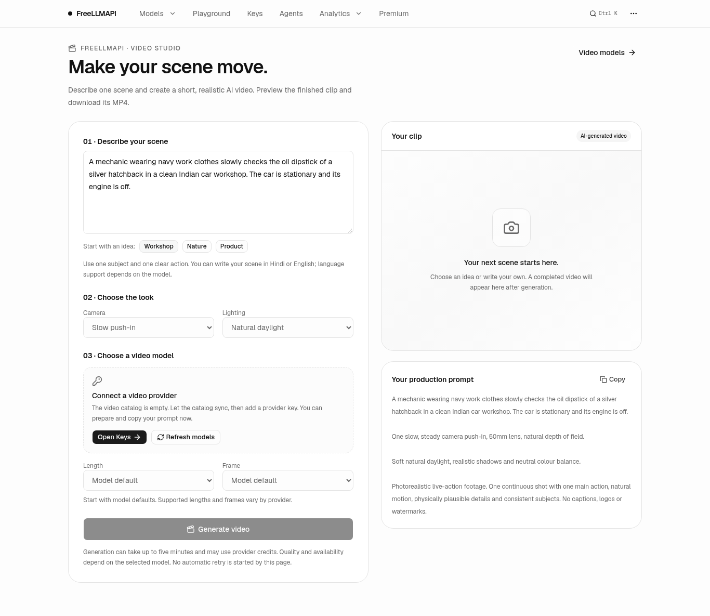

# FreeLLMAPI Video Studio

[Download the Windows setup package](https://github.com/shanipratapsingh018/Project/raw/refs/heads/video-studio-downloads/video-studio/video-studio-windows.zip)

1. Download the ZIP and choose **Extract All** in Windows.
2. Open the extracted folder and double-click **START_VIDEO_STUDIO.cmd**.
3. If Node.js is missing, install it using the official Node.js 24 download opened by the launcher, then reopen the launcher.
4. The first run installs dependencies, builds the app and opens its local browser page. Keep the terminal window open.
5. Create your own dashboard account. Add your video-provider key privately on **Keys**, enable a video model and generate a clip.

Provider video access and available credits/quota are required. Realistic AI video generation has not been verified with a live provider; browser checks used an explicitly fictional test clip. Never paste provider keys into chat or public files.

## Preview

## Package details

- Implementation revision: `2bcf784a6216d8f9ab5cb6d2fc8418b13dd84ab5`.
- The ZIP includes the source, MIT licence, Windows launcher, setup guide and validation record.
- It excludes API keys, local configuration, databases and installed dependencies.
- Build and browser checks passed. The desktop install/build/start flow was tested on Linux; the Windows CMD entry point was reviewed but not executed on a Windows runner.

## Hindi quick guide

ZIP download karke **Extract All** karein. Folder mein **START_VIDEO_STUDIO** par double-click karein. Pehli baar setup mein kuch samay lag sakta hai; browser app ready hone par khulega. Cloud Environment settings ki zaroorat nahi hai. Video banane ke liye provider access aur quota chahiye.
